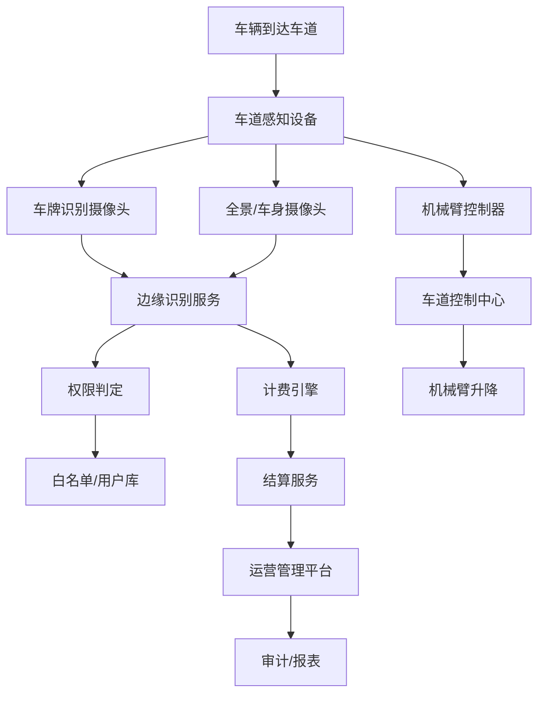
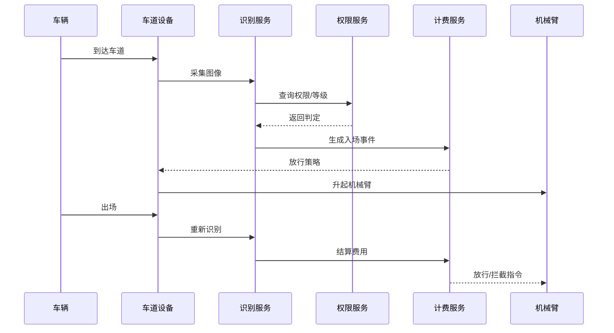
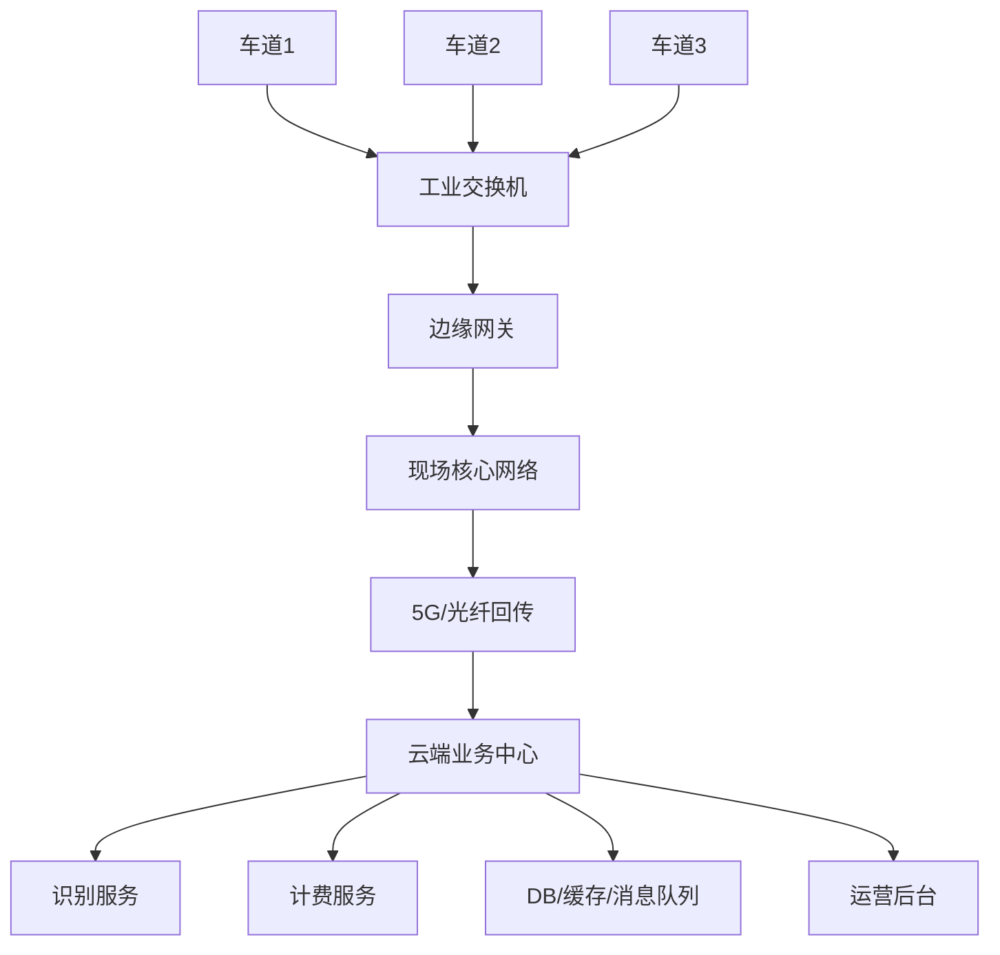

# 机械臂替代岗亭人员无人放行方案

## 第1页：项目概述

### 主题：机械臂替代岗亭人员无人放行方案

- 目标：实现车辆自动识别、自动放行、自动计费
- 适用场景：工厂、园区、企业、社区、停车场
- 核心价值：降低人工成本，提高通行效率，保障安全

---

## 第2页：业务痛点

### 1）车辆计费功能
- 车辆类型和用户等级不同，收费规则不同
- 进出场时间维度不一致，容易产生收费误差
- 需要支持白名单、VIP、临时车、超时违约处理

### 2）特殊拍照识别能力
- 夜间、逆光、遮挡、雨雪、污损导致识别失败
- 临时牌、无牌车、异形车牌场景识别困难
- 复杂环境下单镜头识别可靠性不足

---

## 第3页：总体架构

---

## 第4页：系统架构图

### 车道层
- 车牌相机
- 车身相机
- 机械臂控制器
- 车道控制主机
- LED屏和语音播报

### 业务层
- 车辆识别服务
- 权限服务
- 计费服务
- 审核服务

### 管理层
- 运营后台
- 报表中心
- 审计留痕
- 设备运维

---

## 第5页：车辆计费能力

### 核心方案
- 入场：识别信息+用户等级+权限判定
- 出场：重新识别+停留时长计算+费用计算
- 结算：规则引擎生成订单并支付/扣款
- 审计：记录时序、规则版本、金额明细

### 支持的计费规则
- 按时长计费
- 按次计费
- 用户等级折扣
- 节假日价格策略
- 超时补费
- 白名单/免费通行

---

## 第6页：特殊拍照识别能力

### 关键技术
- 多摄像头协同识别
- 图像增强与低照度补偿
- 遮挡、反光、污损处理
- 补拍重试机制
- 人工审核平台

### 典型场景
- 夜间车牌模糊
- 车牌覆盖/反光
- 临时牌照识别
- 低置信度车辆进审核台

---

## 第7页：业务流程

---

## 第8页：数据架构

- 车辆主数据：车牌、车型、颜色、绑定用户
- 用户权限库：VIP、白名单、黑名单、免费资格
- 订单库：入场时间、出场时间、金额、支付状态
- 图片库：识别图、补拍图、视频录像
- 审计库：操作日志、设备状态、规则版本

---

## 第9页：网络部署图

---

## 第10页：实施建议

### 分阶段落地
1. 基础版：识别 + 放行 + 计费
2. 增强版：补拍 + 人工审核 + 多摄像头协同
3. 平台版：统一管理 + 报表 + 数据中台

### 关键技术路线
- 后端：Java / Go
- 前端：Vue / React
- 数据：MySQL + Redis + Kafka
- AI：OpenCV + 深度学习
- 运维：Prometheus + Grafana

---

## 第11页：结论

该方案通过“边缘识别 + 自动计费 + 智能审核”的方式，实现机械臂替代岗亭人员的无人放行能力，满足高效、安全、低成本和可追溯的业务要求。

核心优势：
- 自动识别车辆
- 自动判定用户等级
- 自动计费结算
- 特殊场景人工审核
- 持续支持扩展

---

## 第12页：结束

谢谢
