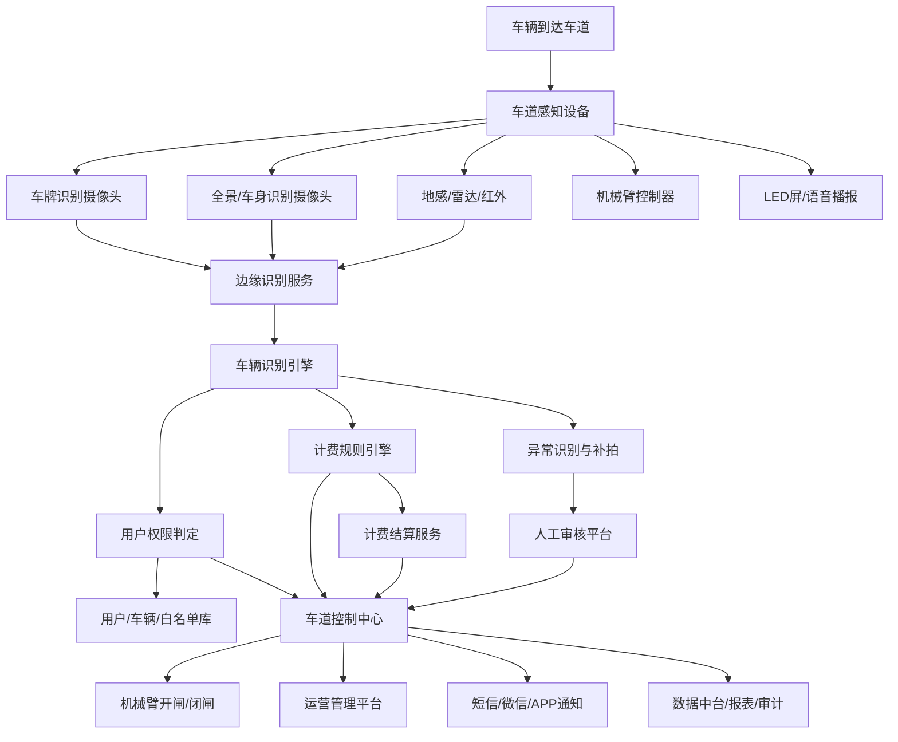
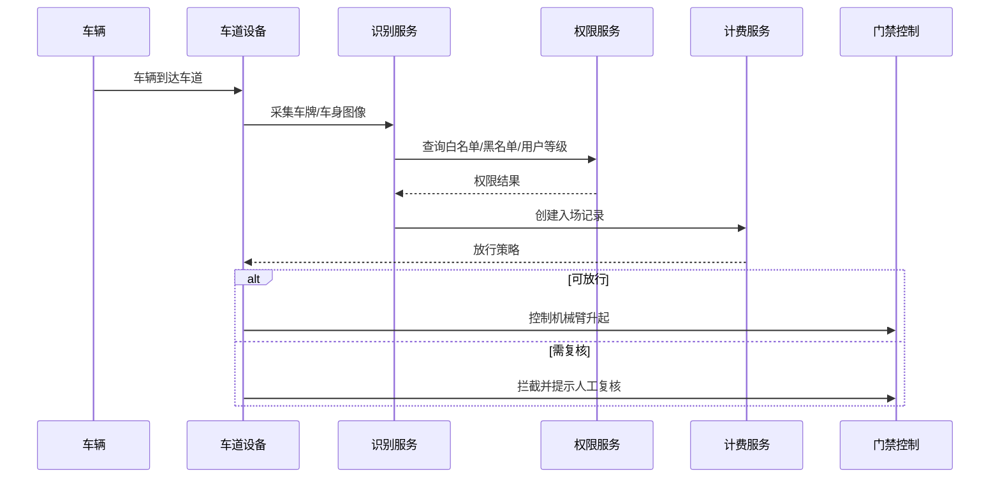
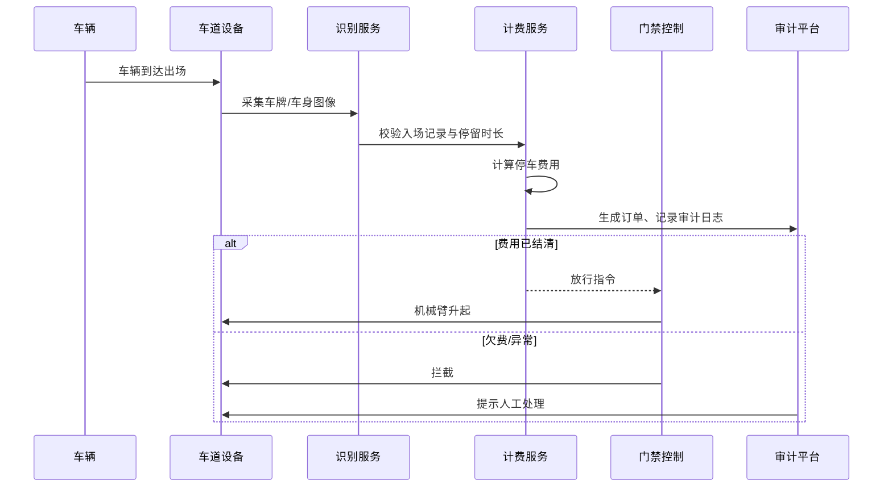
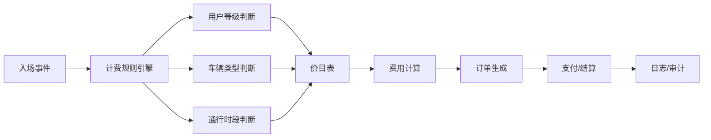
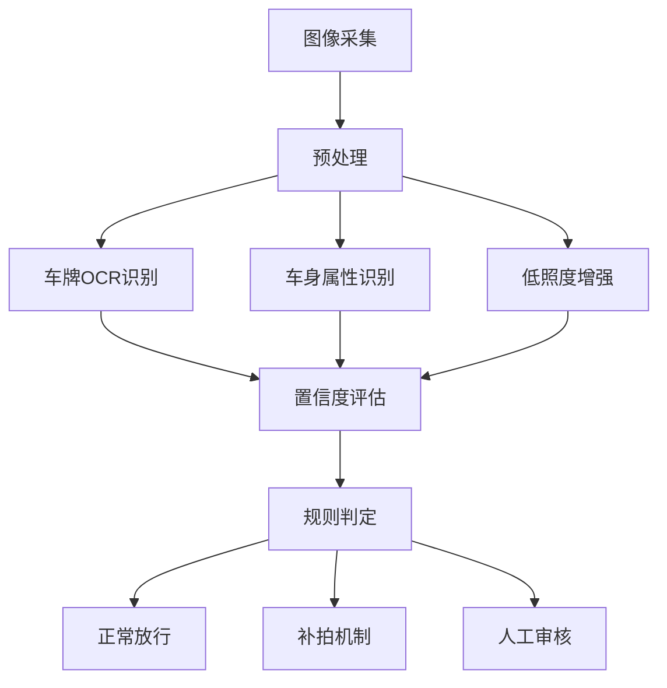
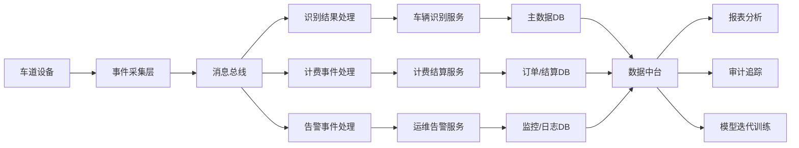
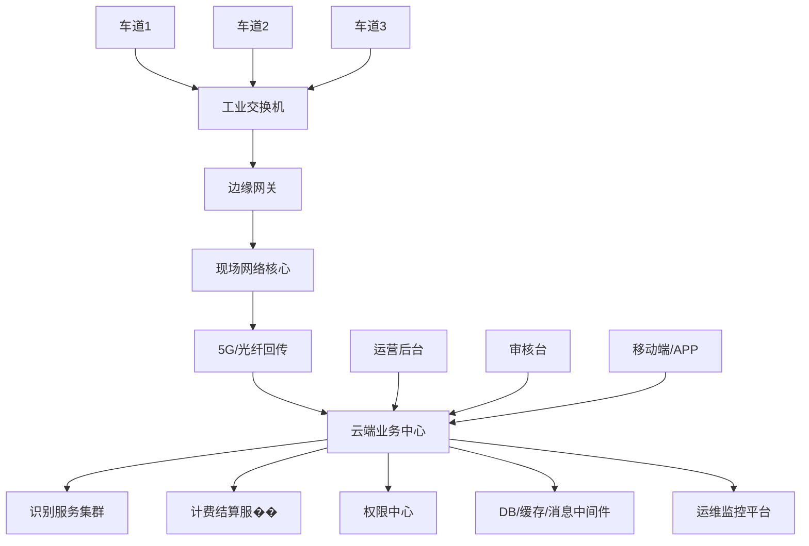

# 机械臂替代岗亭人员无人放行方案（技术实现方案）

## 1. 项目背景

为提升车道通行效率、降低人工岗亭成本、减少人员操作误差，本方案采用机械臂 + 车牌识别 + 用户权限判定 + 自动计费的无人放行体系，替代传统岗亭人员的车辆放行和计费处理。

该系统重点解决两个核心问题：

- 1）车辆计费功能：实现自动识别、自动计费、自动结算、自动记录
- 2）特殊拍照识别能力：解决低照度、遮挡、反光、临时号牌、特殊车型等场景中识别难题

---

## 2. 总体目标

- 自动识别车辆和车牌
- 自动识别用户等级、白名单、VIP、黑名单状态
- 自动判定放行或拦截
- 自动计算停车费用并完成结算
- 自动记录通行日志和审计证据
- 在异常场景下触发补拍与人工审核

---

## 3. 系统总体架构

### 3.1 架构分层说明

#### 车道层
- 车牌识别摄像头
- 车身识别相机
- LED显示屏
- 机械臂控制器
- 车道控制器
- 车道边缘网关

#### 业务层
- 车辆识别引擎
- 权限认证服务
- 计费规则引擎
- 结算服务
- 异常审核服务
- 设备控制服务

#### 数据层
- 用户主数据
- 车辆主数据
- 计费规则库
- 订单库
- 图片/视频库
- 审计日志库

#### 管理层
- 运营后台
- 设备管理平台
- 报表中心
- 大屏监控
- 人工审核台

---

## 4. 业务流程设计

### 4.1 车辆入场流程

### 4.2 车辆出场流程

---

## 5. 车辆计费功能设计

### 5.1 计费目标

实现自动计费、自动结算、对账管理、异常处理，满足多种收费场景：

- 按时长收费
- 按次收费
- 按车类收费
- 按用户等级收费
- 白名单免费通行
- VIP/企业用户优惠
- 节假日/特殊时段优惠
- 超时/违约车补费

### 5.2 计费核心架构

### 5.3 计费规则设计

计费规则基于以下维度组合：

- 用户等级：普通用户、VIP、白名单、黑名单、临时用户
- 车辆类型：小车、货车、工程车、特殊车辆
- 时间段：工作日/节假日/夜间/高峰期
- 优惠策略：月卡、年卡、企业协议、节假日优惠
- 停放时长：按分钟/小时计费
- 违约规则：超时、违规停放、异常出场

### 5.4 计费流程

- 入场时：车牌识别 + 用户级别判定 + 生成入场记录 + 绑定计费对象
- 出场时：重新识别 + 计算停留时长 + 调用计费规则 + 生成订单
- 结算：支持微信支付、支付宝支付、现金支付、余额扣款、月卡结算
- 结算后：写入订单表、更新通行状态、输出审计日志

### 5.5 计费场景举例

- 普通车：普通时段按时计费
- 白名单车辆：免费放行
- VIP车辆：按折扣费率计费
- 临时车：按次/按时计费
- 超时车辆：追加超时费
- 异常车辆：人工审核后处理

---

## 6. 特殊拍照识别能力设计

### 6.1 业务挑战

特殊拍照识别重点解决以下问题：

- 夜间低照度导致车牌看不清
- 污损、遮挡、反光导致识别失败
- 临时牌照、无牌车、异形车牌识别问题
- 车身或车牌被遮挡时误判
- 连续放行场景多车混行导致识别冲突
- 车牌与用户权限不一致时识别纠纷

### 6.2 识别能力架构

### 6.3 核心技术方案

#### 1）多摄像头协同识别
- 主摄像头识别车牌
- 辅助摄像头识别车身、颜色、车型、车头/车尾特征
- 多视角融合，提高识别稳定性

#### 2）图像增强技术
- 夜间增强
- 逆光补偿
- 去模糊与去噪
- 反光抑制
- 雨雪天气增强

#### 3）补拍机制
- 当识别置信度低于门槛时，触发第二次拍照
- 不同曝光和不同角度拍摄多次
- 最优结果入库并作为判定依据

#### 4）人工审核系统
- 低置信度车辆自动进入审核台
- 审核员可回看图片、视频与历史记录
- 人工确认结果回写系统并更新模型训练样本

### 6.4 特殊场景识别策略

- 临时牌照：提高识别模型和规则校验优先级
- 遮挡车辆：通过补拍+车身比对机制判定
- 黑名单/异常车：优先拒绝并进入人工审核
- 白名单车：优先放行，必要时进行二次确认
- 多车连续通行：通过车道感知和时间窗口判定

---

## 7. 数据架构设计

### 数据对象设计

- 车辆主表：车牌、颜色、车型、用户ID、状态
- 用户表：用户ID、等级、权限、优惠规则
- 通行记录表：时间、地点、车牌、识别结果、放行状态
- 订单表：入场时间、出场时间、费率、金额、状态
- 图片表：图片地址、设备ID、时间戳、置信度
- 审计表：系统操作、设备状态、审核结果、异常记录

---

## 8. 网络部署设计

### 8.1 网络特点

- 现场网络采用局域网和工业级交换机
- 边缘网关负责本地数据处理与上云通信
- 云端应用实现集中管理、分析和审计
- 支持双链路、网络冗余和断网本地保护
- 所有车道设备和云端应用均采用加密通信

---

## 9. 安全与运维设计

### 9.1 安全设计

- 设备认证与访问控制
- 车道控制指令加密
- 图片与识别数据加密存储
- 审计日志不可篡改
- 运营后台岗位权限隔离

### 9.2 运维设计

- 设备在线率监控
- 识别成功率监控
- 计费误差分析
- 图片质量巡检
- 异常告警自动推送
- 规则版本和模型版本治理

---

## 10. 实施方案

### 第一期：基础放行版

- 车牌识别
- 机械臂控制
- 用户权限判定
- 基础收费规则
- 通行记录和审计日志

### 第二期：智能计费版

- 多种计费规则
- 优惠和减免策略
- 订单和结算管理
- 支付方式接入

### 第三期：特殊识别版

- 多摄像头识别
- 补拍和人工审核
- 低照度/遮挡场景增强
- 特殊车识别优化

### 第四期：平台化扩展

- 多车道统一管理
- 数据中台
- 报表中心
- 设备健康治理
- AI模型持续迭代

---

## 11. 方案价值

- 节省人工岗亭人员成本
- 提升车道通行效率
- 降低错误放行和误收费风险
- 支持多种计费模式和等级权限
- 提升特殊场景识别准确率
- 增强审计和运营追踪能力

---

## 12. 结论

本方案通过车牌识别、用户权限判定、机械臂控制和统一计费引擎相结合，能够在无人岗亭场景中实现稳定、高效、安全的车辆放行和结算。特别是对车辆计费和特殊拍照识别两大核心难点，采用边缘计算 + 多摄像头协同 + 补拍机制 + 人工审核的闭环方案，可显著提升系统可靠性和实际落地价值。

该方案适合应用于园区、工厂、社区、停车场、企业出入口等各类无人放行场景。

---

## 13. 关键技术路线建议

- 后端：Java Spring Boot / Go
- 数据库：MySQL + Redis + Elasticsearch
- 消息中间件：Kafka
- 视频存储：对象存储
- AI识别：OpenCV + 深度学习模型
- 前端：Vue / React
- 容器化：Docker + Kubernetes
- 运维：Prometheus + Grafana

---

## 14. 一句话总结

本项目不是简单的“门禁控制”，而是一个集“自动识别、自动放行、自动计费、特殊拍照识别、人工复核、审计追踪”于一体的智能车道控制系统。

